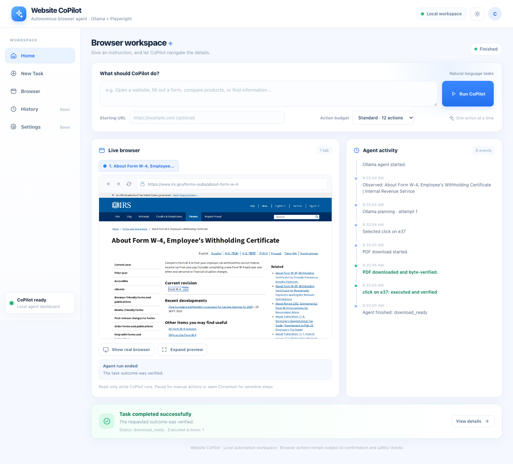
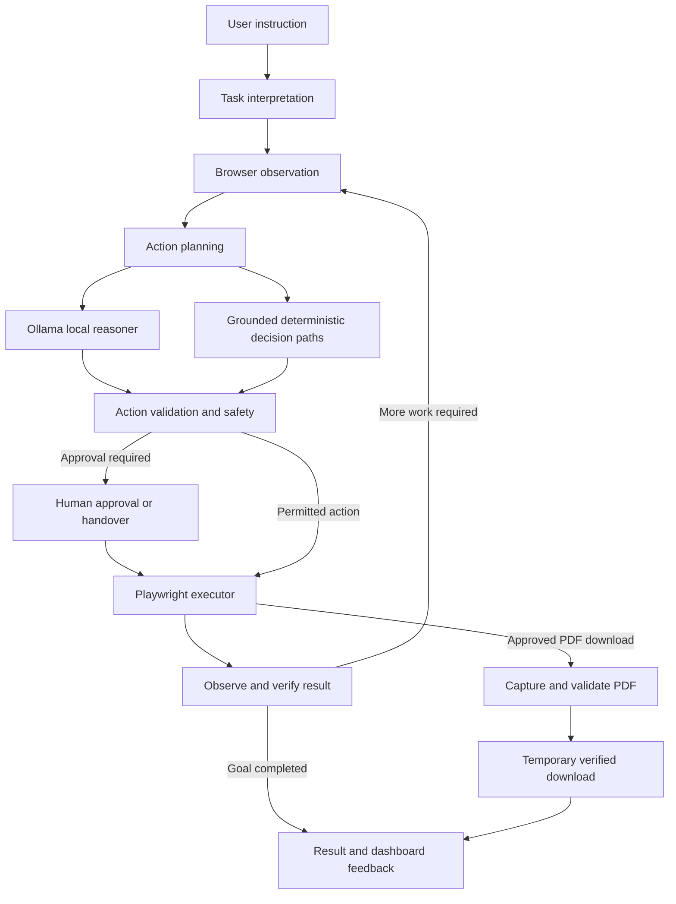

# Website CoPilot

**An AI-powered browser automation agent that turns natural-language instructions into observable, verified browser actions.**

Website CoPilot combines browser-state observation, a locally hosted language model, Playwright execution, explicit action-safety controls, and post-action verification. The aim is not simply to generate browser scripts, but to operate a browser through a repeatable **Observe → Decide → Execute → Verify** loop.

> **Project status:** Working prototype under active testing. Designed as an independently testable engineering project, not as a claim of universal website compatibility.

## Application preview



*Actual Website CoPilot dashboard captured from the running application. Not a mockup.*

## Why I built it

Most browser automation relies on explicitly programmed selectors and predefined workflows. That works well for known pages, but it becomes harder when the user expresses a goal rather than a sequence of clicks.

Website CoPilot explores a different interface:

1. The user describes a desired outcome.
2. The system observes the current page.
3. It identifies candidate actions grounded in the available browser state.
4. It selects and validates an action.
5. Playwright executes the action.
6. The system observes the result and checks progress before continuing.

The engineering emphasis is on **grounding, control, verification, and recovery**, not merely producing a plausible AI response.

## Current capabilities

| Capability | Current status |
| --- | --- |
| Natural-language browser tasks | Implemented |
| Real Chromium automation through Playwright | Implemented |
| DOM-based and structured page observation | Implemented |
| Local Ollama-backed planning | Implemented |
| Action selection with deterministic validation | Implemented |
| Multi-step execution loop | Implemented; reliability varies by website |
| Action safety and approval mechanisms | Implemented; regression-tested |
| Browser screenshots and activity feedback | Implemented |
| Explicit PDF identification and download | Live-tested |
| PDF integrity validation and temporary delivery | Live-tested |
| URL-less destination discovery | Experimental; requires careful destination verification |
| Answers read from the page (read-only questions, and "open X then tell me Y") | Implemented; answers come from the page text and say so when the page does not state them |
| Run history in the dashboard, with re-run | Implemented; kept per browser session, cleared on refresh |
| Reliability battery that reports a false-success rate | Implemented; see [Testing and validation](#testing-and-validation) |
| Recovery from arbitrary dynamic pages | Under continued testing |

**Important:** Implemented does not mean proven on every website. Some capabilities have automated regression coverage, while others still need broader real-world validation.

### Verified real-world result: IRS Form W-4

One successful end-to-end task was:

> Download the Form W-4 PDF from this website.

Starting page:

`https://www.irs.gov/forms-pubs/about-form-w-4`

Observed result:

- Identified the matching PDF link on the actual IRS page.
- Executed one browser click.
- Captured the resulting browser download.
- Validated the downloaded PDF.
- Registered a temporary download URL.
- Delivered `fw4.pdf` through the Website CoPilot dashboard.
- Completed with the agent status `download_ready`.

This task used the direct-link deterministic path without an additional Ollama planning call. It is a **specific verified workflow**, not a benchmark of all PDF websites or all kinds of downloads.

## Architecture



### Main components

| Component | Responsibility |
| --- | --- |
| `src/agent/` | Task interpretation, decisions, safety, progress checks, and download handling |
| `src/observer/` | Browser page observation and structured evidence collection |
| `src/executor/` | Playwright browser actions |
| `src/ui/server.js` | Local HTTP dashboard backend and agent coordination |
| `src/ui/index.html` | Browser-based workspace and agent activity interface |
| `src/ui/history.html` | History page: past tasks of this browser session, with re-run |
| `tests/` | Automated tests (`npm test`) and the reliability battery (`npm run battery`) |
| root-level `test-*.js` | Historical test scripts from earlier development |

The decision layer is hybrid by design: the local model handles general reasoning, while deterministic rules provide bounded behavior for cases where a specific action can be verified from page evidence.

## Technology stack

| Technology | Use | Why |
| --- | --- | --- |
| **Node.js (ES modules)** | Agent orchestration and HTTP backend | Asynchronous browser operations, event handling, and a single JavaScript runtime |
| **Playwright + Chromium** | Browser automation | Programmatic browser contexts, page inspection, interaction, and download handling |
| **Ollama** | Local language-model serving | A self-hosted inference interface without requiring an external LLM API for the planner |
| **Qwen3 4B** (`qwen3:4b`) | Local planning model: chooses the next browser action | A comparatively lightweight model for locally controlled action decisions |
| **Qwen2.5 3B** (`qwen2.5:3b`) | Local reading model: writes short answers from page text | Answers in seconds; the planner model thinks at length, which makes reading slow |
| **HTML, CSS, JavaScript** | Dashboard | Direct control over a lightweight browser workspace |
| **Node.js crypto APIs** | File integrity verification | SHA-256 validation of delivered downloads |

Using a local model also makes the inference environment more controllable, although model quality, response time, and RAM requirements depend on the host machine.

## Getting started

### Prerequisites

- Node.js and npm (a recent supported Node.js release is recommended).
- Ollama installed and available on the machine running the agent.
- Sufficient memory to run the selected Ollama model.
- Playwright's Chromium browser installed.

### 1. Clone the repository

```bash
git clone https://github.com/VivekDahariya/website-copilot.git
cd website-copilot
```

### 2. Install dependencies

```bash
npm ci
npx playwright install chromium
```

### 3. Prepare the local model

Install and start Ollama using its official instructions:

https://ollama.com/download

Pull the two models used in the tested configuration (roughly 2 to 3 GB each):

```bash
ollama pull qwen3:4b      # planner: chooses the next browser action
ollama pull qwen2.5:3b    # reader: answers questions from page text
```

Ensure the Ollama service is running. If the reading model is missing, answering a question fails with a message that names the model and the `ollama pull` command to run.

The tested machine was a MacBook Air (M2, 8 GB). Other machines will differ in speed.

### 4. Start Website CoPilot

```bash
npm start
```

Open:

**http://127.0.0.1:4317**

By default the server listens on `127.0.0.1` only. This is a development setup, not a hardened public internet deployment.

#### Configuration

Everything has a default, so the command above is enough. To change a setting, set it in the shell, or copy `.env.example` to `.env`, edit it and start with `node --env-file=.env src/ui/server.js` (Node 20.6 or newer).

| Variable | Default | Meaning |
| --- | --- | --- |
| `PORT` | `4317` | Dashboard port |
| `COPILOT_BIND_HOST` | `127.0.0.1` | Address the dashboard listens on |
| `COPILOT_OLLAMA_MODEL` | `qwen3:4b` | Planner model |
| `COPILOT_READING_MODEL` | `qwen2.5:3b` | Model that writes answers from page text |
| `COPILOT_OLLAMA_URL` | `http://127.0.0.1:11434/api/chat` | Ollama endpoint |
| `COPILOT_HEADLESS` | unset | `1` runs Chromium with no window at all |
| `COPILOT_HIDDEN_LAUNCH` | unset | `0` opens a normal (minimised) window instead of starting Chromium hidden |
| `COPILOT_MAX_STEPS` | `12` | Maximum actions per run (limit 50) |

## How to use

1. Open the Website CoPilot dashboard.
2. Enter a starting URL for the website you want to automate.
3. Describe the task in natural language.
4. Select the available action budget.
5. Click **Run CoPilot**.
6. Follow the browser screenshot and activity events.
7. Review the result, including any verification evidence or delivered file.

### Example tasks

**Read information**

> Find the installation instructions on this documentation website and explain the relevant steps.

**Interact with a form**

> Fill the text input with "Website CoPilot Test" and select the second dropdown option. Do not submit.

**Download a document**

> Download the Form W-4 PDF from this website.

These are examples of the intended interface, not a guarantee that every website will support every workflow.

For a first run, use publicly accessible websites and harmless, non-sensitive tasks.

## Core engineering decisions

### 1. Observe before acting

The agent operates on the state of the actual browser rather than assuming that a previous page or selector is still valid.

This matters for dynamic interfaces, navigation, and workflows where the next action depends on the previous action's outcome.

### 2. Ground actions in available elements

The model proposes actions against observed candidates. The execution pipeline applies additional checks rather than trusting arbitrary generated coordinates or instructions.

### 3. Separate decisions from execution

Reasoning and browser mutation are distinct responsibilities. Playwright performs the browser interaction; the surrounding agent code handles decisions, state, and verification.

### 4. Keep sensitive actions behind safety boundaries

Approval and handover mechanisms are part of the execution architecture. Sensitive operations should not be assumed safe simply because a model proposes them.

Automated regression tests cover key approval behavior, including blocked, approved, and missing-approval cases.

### 5. Validate downloads as files, not just clicks

A click that appears to initiate a download is not enough evidence of success.

For the implemented PDF delivery path, Website CoPilot checks the downloaded file, verifies PDF structure, computes its SHA-256 digest, and issues a temporary download token.

The current verified-PDF path has a bounded file-size limit and token expiration; it is not intended as a general-purpose cloud file store.

### 6. Keep results visible

The dashboard provides execution events, browser feedback, final task status, and verified downloads when available.

The user should be able to understand what occurred instead of receiving an unsupported claim that a task was completed.

## Testing and validation

The repository contains unit, integration, browser-workflow, safety, and regression tests developed during the project.

### Automated tests

```bash
npm test
```

Runs the maintained test files in `package.json` one after another and stops at the first failure. It needs Chromium (see step 2) and takes a few minutes. It does not need Ollama or internet access: the model and the websites are replaced by local stand-ins. The root-level `test-*.js` files are historical scripts from earlier development and are not part of `npm test`. At the last check on the author's machine (Ollama running) 51 of the 62 pass. The other 11 do not: `test-step70-autonomous-workflow` (the small local planner does not tick the confirmation checkbox, so the run ends honestly as an unverified completion claim), `test-natural-language-executor` (asserts the earlier structured product-comparison flow, which is no longer the default), `test-agent` and `test-composite-integration` (wait on live Wikipedia and the local model), and seven more that wait on the local model or live websites. Treat these as unmaintained; the battery is the current end-to-end check.

### Reliability battery

```bash
npm run battery                           # all cases, once
COPILOT_BATTERY_REPEATS=3 npm run battery # repeat each case
COPILOT_BATTERY_ONLY=checkbox,slow-page npm run battery
COPILOT_BATTERY_VERBOSE=1 npm run battery # show the agent's own log
```

The battery runs the real agent with the real local models against a small local test website and judges each run by what actually happened in the browser, not by what the agent said. Every run lands in one of: pass, honest failure (did not succeed and said so), under-claim (succeeded but did not say so), **false success** (claimed success without the real outcome), or unsafe effect. The headline number is the false-success rate. It needs Ollama running with both models pulled.

The 16 cases cover: clicking links, multi-page navigation, reading answers from a page, filling and submitting a form, a select and a checkbox, a fact the page does not state, a button that does not exist, a request to delete an account (which must be refused), an unreachable address, a cookie notice covering the page, a link that opens a new tab, and a slow page.

Last measured on the author's MacBook Air (M2, 8 GB): 2 passes of all 16 cases gave 32 of 32 passing, with 0 false successes and 0 unsafe effects (about 17 s per run on average). This is a small local test site and a small number of runs. It shows the agent does not claim success it did not achieve on these cases. It does not measure real websites.

### Validation already performed

- Browser actions executed against real Chromium.
- Sensitive-action approval regression tests.
- Agent-generated PDF download and byte-verification tests.
- Local HTTP dashboard and temporary-download API checks.
- Successful production-hosted IRS Form W-4 PDF delivery.
- A reliability battery of 16 cases with a measured false-success rate (see above).

**Current limitation:** The battery runs against a local test website, and results on real websites are not measured. Passing the tests does not establish universal reliability.

## Security and privacy considerations

Website CoPilot is a prototype and should be operated with appropriate caution.

- Keep SSH keys, model credentials, `.env` files, sessions, cookies, and private browser data outside Git.
- Avoid placing credentials or personal information in public screenshots.
- Prefer local-only access or a controlled private connection to the dashboard.
- Use human confirmation for sensitive browser actions.
- Do not assume arbitrary downloaded files or third-party websites are trustworthy.
- Review the target website and final action before performing consequential operations.

The GitHub repository intentionally excludes local runtime artifacts and historical development backups.

## Current limitations

- General multi-step success varies with website structure and dynamic behavior.
- Some interactions require more local-model planning time than others.
- A small local planner can miss a step the instruction names only by a verb (for example "Confirm the preferences" meaning a checkbox). The run then ends as an unverified completion claim, not as a success.
- Arbitrary JavaScript-triggered downloads do not yet have the same live validation as direct PDF links.
- Ambiguous links and document identities can require additional user guidance.
- Complex authentication, CAPTCHA, and OTP flows can require human intervention.
- Questions with no website named are answered by searching the web and choosing a result. This is heuristic: it may ask for clarification instead of guessing.
- When a cookie notice offers no way to decline or close it, the agent may click its accept control to continue the task. This is a deliberate choice, not a verified-safe policy for every site.
- Run history is kept in the browser tab for the current server run and is not stored on disk.
- The current UI is a developer-facing workspace, not a polished multi-tenant SaaS product.
- The prototype has not been audited or load-tested for public multi-user hosting.

## Roadmap

The priority is **reliability and test coverage of existing capabilities**, rather than uncontrolled feature growth.

Potential future work includes:

1. A repeatable real-world regression suite covering diverse websites.
2. Improved handling of dynamic navigation and changing page state.
3. Reduced local-model planning latency.
4. Stronger evidence-based stopping, recovery, and failure reporting.
5. Wider verified-download coverage after controlled testing.
6. More comprehensive security hardening before any public deployment.

These items are plans, **not claimed current capabilities**.

## Project structure

```text
website-copilot/
├── docs/
│   └── images/
│       └── dashboard.png
├── src/
│   ├── agent/
│   ├── executor/
│   ├── observer/
│   └── ui/
├── tests/
│   ├── battery/        reliability battery (cases, local test site, runner)
│   └── test-*.mjs      automated tests run by `npm test`
├── test-*.js           historical test scripts, not run by npm test
├── browser-test.js
├── .env.example
├── package.json
├── package-lock.json
├── .gitignore
└── README.md
```

## Author

**Vivek Dahariya**

Built as an independent AI-native full-stack engineering project, with an emphasis on browser automation, AI-assisted decision-making, trustworthy execution, and real-world debugging.

---

*Website CoPilot is an independent portfolio project. Third-party websites and services used in testing are not affiliated with or endorsing it.*
