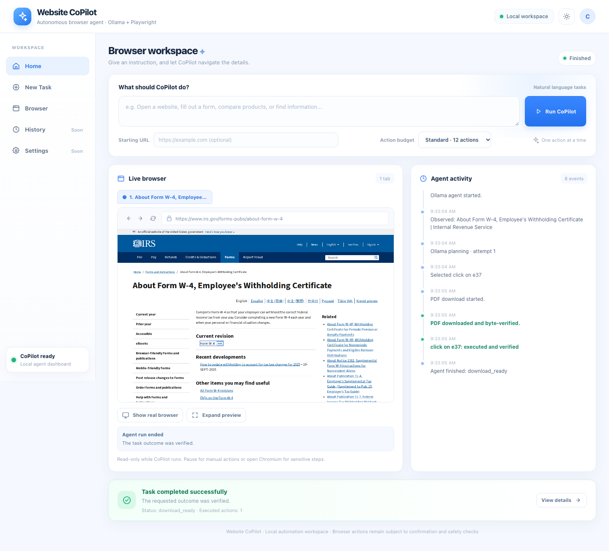
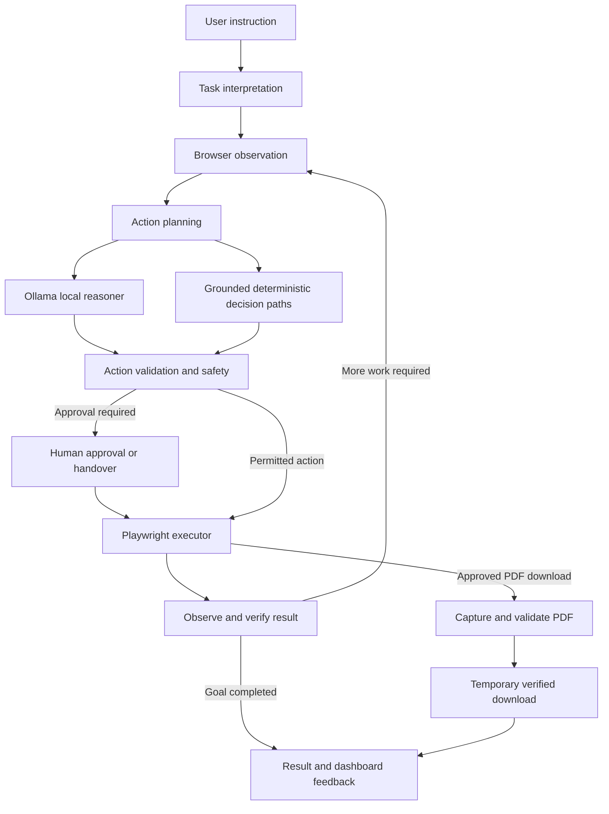

# Website CoPilot

**An AI-powered browser automation agent that turns natural-language instructions into observable, verified browser actions.**

Website CoPilot combines browser-state observation, a locally hosted language model, Playwright execution, explicit action-safety controls, and post-action verification. The aim is not simply to generate browser scripts, but to operate a browser through a repeatable **Observe → Decide → Execute → Verify** loop.

> **Project status:** Working prototype under active testing. Designed as an independently testable engineering project, not as a claim of universal website compatibility.

## Application preview



*Actual Website CoPilot dashboard captured from the running application. Not a mockup.*

## Why I built it

Most browser automation relies on explicitly programmed selectors and predefined workflows. That works well for known pages, but it becomes harder when the user expresses a goal rather than a sequence of clicks.

Website CoPilot explores a different interface:

1. The user describes a desired outcome.
2. The system observes the current page.
3. It identifies candidate actions grounded in the available browser state.
4. It selects and validates an action.
5. Playwright executes the action.
6. The system observes the result and checks progress before continuing.

The engineering emphasis is on **grounding, control, verification, and recovery**, not merely producing a plausible AI response.

## Current capabilities

| Capability | Current status |
| --- | --- |
| Natural-language browser tasks | Implemented |
| Real Chromium automation through Playwright | Implemented |
| DOM-based and structured page observation | Implemented |
| Local Ollama-backed planning | Implemented |
| Action selection with deterministic validation | Implemented |
| Multi-step execution loop | Implemented; reliability varies by website |
| Action safety and approval mechanisms | Implemented; regression-tested |
| Browser screenshots and activity feedback | Implemented |
| Explicit PDF identification and download | Live-tested |
| PDF integrity validation and temporary delivery | Live-tested |
| URL-less destination discovery | Experimental; requires careful destination verification |
| Recovery from arbitrary dynamic pages | Under continued testing |

**Important:** Implemented does not mean proven on every website. Some capabilities have automated regression coverage, while others still need broader real-world validation.

### Verified real-world result: IRS Form W-4

One successful end-to-end task was:

> Download the Form W-4 PDF from this website.

Starting page:

`https://www.irs.gov/forms-pubs/about-form-w-4`

Observed result:

- Identified the matching PDF link on the actual IRS page.
- Executed one browser click.
- Captured the resulting browser download.
- Validated the downloaded PDF.
- Registered a temporary download URL.
- Delivered `fw4.pdf` through the Website CoPilot dashboard.
- Completed with the agent status `download_ready`.

This task used the direct-link deterministic path without an additional Ollama planning call. It is a **specific verified workflow**, not a benchmark of all PDF websites or all kinds of downloads.

## Architecture



### Main components

| Component | Responsibility |
| --- | --- |
| `src/agent/` | Task interpretation, decisions, safety, progress checks, and download handling |
| `src/observer/` | Browser page observation and structured evidence collection |
| `src/executor/` | Playwright browser actions |
| `src/ui/server.js` | Local HTTP dashboard backend and agent coordination |
| `src/ui/index.html` | Browser-based workspace and agent activity interface |
| `tests/` and root-level `test-*.js` | Automated tests and regression scenarios |

The decision layer is hybrid by design: the local model handles general reasoning, while deterministic rules provide bounded behavior for cases where a specific action can be verified from page evidence.

## Technology stack

| Technology | Use | Why |
| --- | --- | --- |
| **Node.js (ES modules)** | Agent orchestration and HTTP backend | Asynchronous browser operations, event handling, and a single JavaScript runtime |
| **Playwright + Chromium** | Browser automation | Programmatic browser contexts, page inspection, interaction, and download handling |
| **Ollama** | Local language-model serving | A self-hosted inference interface without requiring an external LLM API for the planner |
| **Qwen3 4B Instruct** | Local planning model used in the tested deployment | A comparatively lightweight model for locally controlled action decisions |
| **HTML, CSS, JavaScript** | Dashboard | Direct control over a lightweight browser workspace |
| **Node.js crypto APIs** | File integrity verification | SHA-256 validation of delivered downloads |

Using a local model also makes the inference environment more controllable, although model quality, response time, and RAM requirements depend on the host machine.

## Getting started

### Prerequisites

- Node.js and npm (a recent supported Node.js release is recommended).
- Ollama installed and available on the machine running the agent.
- Sufficient memory to run the selected Ollama model.
- Playwright's Chromium browser installed.

### 1. Clone the repository

```bash
git clone https://github.com/VivekDahariya/website-copilot.git
cd website-copilot
```

### 2. Install dependencies

```bash
npm ci
npx playwright install chromium
```

### 3. Prepare the local model

Install and start Ollama using its official instructions:

https://ollama.com/download

Pull the model used for the tested configuration:

```bash
ollama pull qwen3:4b-instruct
```

Ensure the Ollama service is running. The model must be available to the backend for tasks requiring model-based decisions.

### 4. Start Website CoPilot

On macOS or Linux:

```bash
PORT=4317 \
COPILOT_OLLAMA_MODEL=qwen3:4b-instruct \
COPILOT_HEADLESS=1 \
node src/ui/server.js
```

Open:

**http://127.0.0.1:4317**

The server runs locally by default in the documented configuration. If port `4317` is occupied, choose another available port.

This is a development setup, not a hardened public internet deployment.

## How to use

1. Open the Website CoPilot dashboard.
2. Enter a starting URL for the website you want to automate.
3. Describe the task in natural language.
4. Select the available action budget.
5. Click **Run CoPilot**.
6. Follow the browser screenshot and activity events.
7. Review the result, including any verification evidence or delivered file.

### Example tasks

**Read information**

> Find the installation instructions on this documentation website and explain the relevant steps.

**Interact with a form**

> Fill the text input with "Website CoPilot Test" and select the second dropdown option. Do not submit.

**Download a document**

> Download the Form W-4 PDF from this website.

These are examples of the intended interface, not a guarantee that every website will support every workflow.

For a first run, use publicly accessible websites and harmless, non-sensitive tasks.

## Core engineering decisions

### 1. Observe before acting

The agent operates on the state of the actual browser rather than assuming that a previous page or selector is still valid.

This matters for dynamic interfaces, navigation, and workflows where the next action depends on the previous action's outcome.

### 2. Ground actions in available elements

The model proposes actions against observed candidates. The execution pipeline applies additional checks rather than trusting arbitrary generated coordinates or instructions.

### 3. Separate decisions from execution

Reasoning and browser mutation are distinct responsibilities. Playwright performs the browser interaction; the surrounding agent code handles decisions, state, and verification.

### 4. Keep sensitive actions behind safety boundaries

Approval and handover mechanisms are part of the execution architecture. Sensitive operations should not be assumed safe simply because a model proposes them.

Automated regression tests cover key approval behavior, including blocked, approved, and missing-approval cases.

### 5. Validate downloads as files, not just clicks

A click that appears to initiate a download is not enough evidence of success.

For the implemented PDF delivery path, Website CoPilot checks the downloaded file, verifies PDF structure, computes its SHA-256 digest, and issues a temporary download token.

The current verified-PDF path has a bounded file-size limit and token expiration; it is not intended as a general-purpose cloud file store.

### 6. Keep results visible

The dashboard provides execution events, browser feedback, final task status, and verified downloads when available.

The user should be able to understand what occurred instead of receiving an unsupported claim that a task was completed.

## Testing and validation

The repository contains unit, integration, browser-workflow, safety, and regression tests developed during the project.

One existing safety regression can be executed with:

```bash
node tests/step74/agent-driven-approval.js
```

Tests that rely on Chromium, Ollama, external websites, or a particular fixture require their respective runtime dependencies.

### Validation already performed

- Browser actions executed against real Chromium.
- Sensitive-action approval regression tests.
- Agent-generated PDF download and byte-verification tests.
- Local HTTP dashboard and temporary-download API checks.
- Successful production-hosted IRS Form W-4 PDF delivery.

**Current limitation:** A complete, reproducible, environment-independent end-to-end test suite has not yet been established. Passing a selected test does not establish universal reliability.

## Security and privacy considerations

Website CoPilot is a prototype and should be operated with appropriate caution.

- Keep SSH keys, model credentials, `.env` files, sessions, cookies, and private browser data outside Git.
- Avoid placing credentials or personal information in public screenshots.
- Prefer local-only access or a controlled private connection to the dashboard.
- Use human confirmation for sensitive browser actions.
- Do not assume arbitrary downloaded files or third-party websites are trustworthy.
- Review the target website and final action before performing consequential operations.

The GitHub repository intentionally excludes local runtime artifacts and historical development backups.

## Current limitations

- General multi-step success varies with website structure and dynamic behavior.
- Some interactions require more local-model planning time than others.
- Arbitrary JavaScript-triggered downloads do not yet have the same live validation as direct PDF links.
- Ambiguous links and document identities can require additional user guidance.
- Complex authentication, CAPTCHA, and OTP flows can require human intervention.
- The current UI is a developer-facing workspace, not a polished multi-tenant SaaS product.
- The prototype has not been audited or load-tested for public multi-user hosting.

## Roadmap

The priority is **reliability and test coverage of existing capabilities**, rather than uncontrolled feature growth.

Potential future work includes:

1. A repeatable real-world regression suite covering diverse websites.
2. Improved handling of dynamic navigation and changing page state.
3. Reduced local-model planning latency.
4. Stronger evidence-based stopping, recovery, and failure reporting.
5. Wider verified-download coverage after controlled testing.
6. More comprehensive security hardening before any public deployment.

These items are plans, **not claimed current capabilities**.

## Project structure

```text
website-copilot/
├── docs/
│   └── images/
│       └── dashboard.png
├── src/
│   ├── agent/
│   ├── executor/
│   ├── observer/
│   └── ui/
├── tests/
├── test-*.js
├── browser-test.js
├── package.json
├── package-lock.json
├── .gitignore
└── README.md
```

## Author

**Vivek Dahariya**

Built as an independent AI-native full-stack engineering project, with an emphasis on browser automation, AI-assisted decision-making, trustworthy execution, and real-world debugging.

---

*Website CoPilot is an independent portfolio project. Third-party websites and services used in testing are not affiliated with or endorsing it.*
